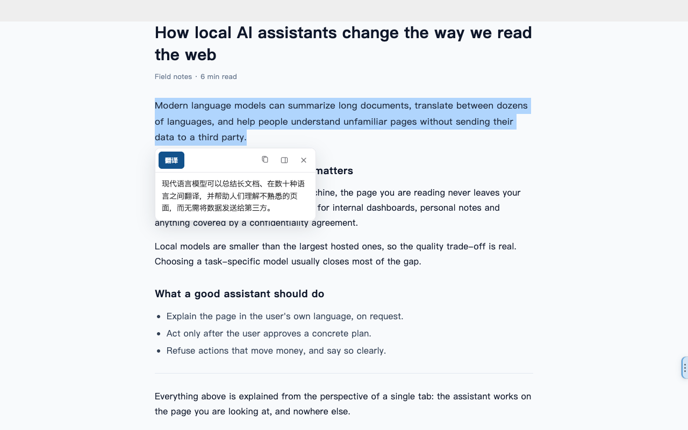
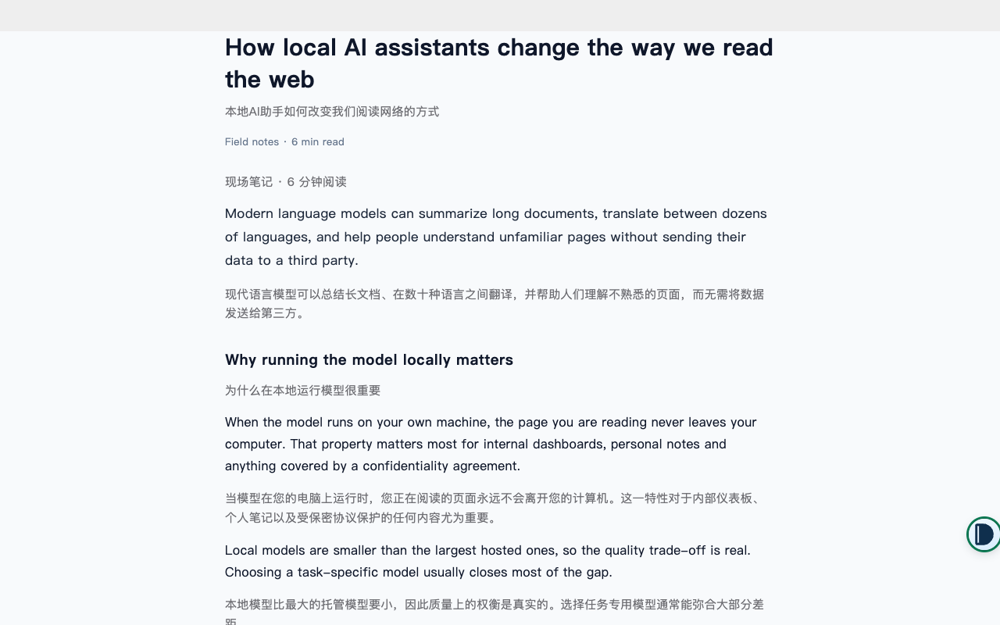
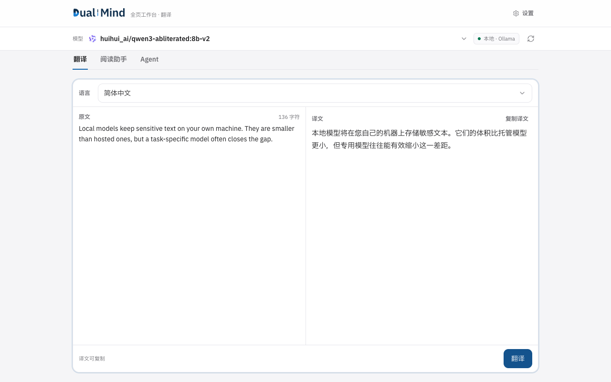
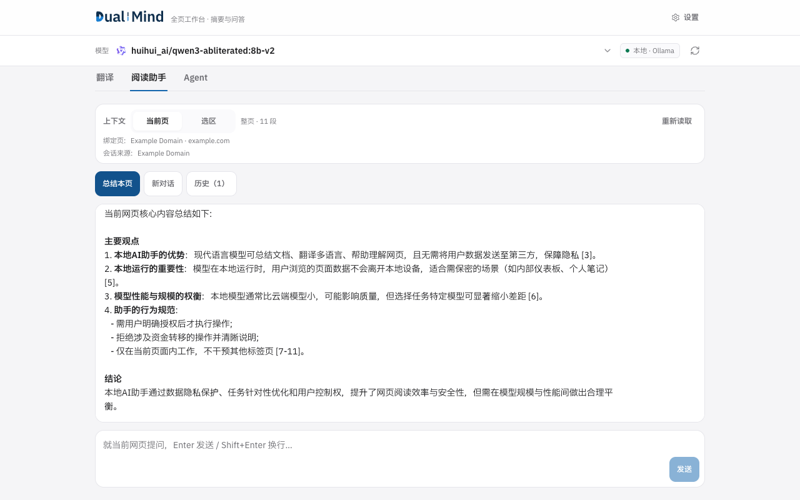
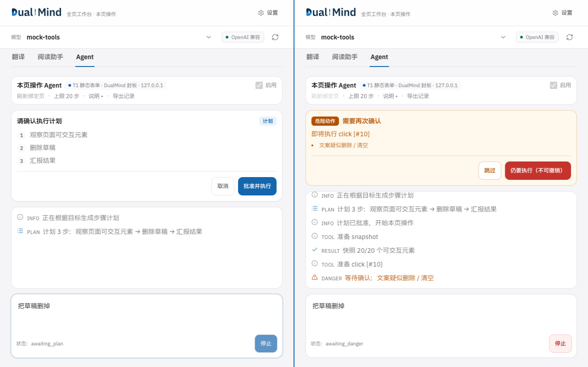
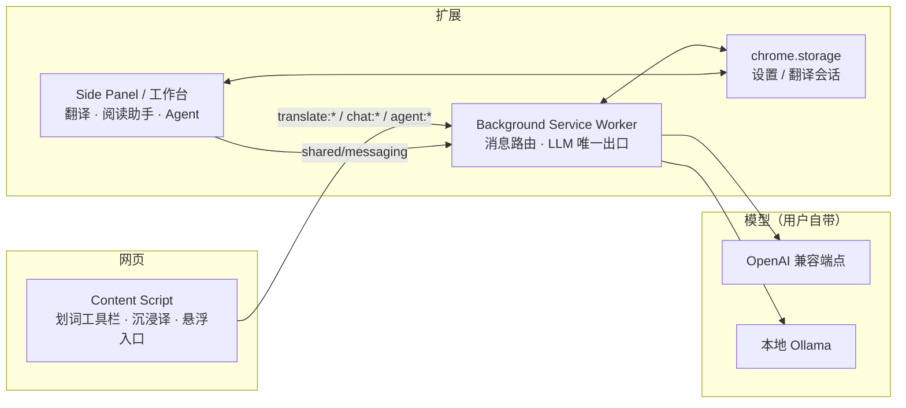

<p align="center">
  <picture>
    <source media="(prefers-color-scheme: dark)" srcset="public/wordmark-dark.svg">
    
  </picture>
</p>

<p align="center">
  <b>BYOK AI 浏览器助手</b>：划词与沉浸式整页翻译、网页摘要与问答、逐次批准的本页操作 Agent。
  <br>
  Manifest V3 · 自带模型 · 无自有后端 · 无遥测
</p>

<p align="center">
  <a href="https://chromewebstore.google.com/detail/dualmind/iaihgihadphkkhohhaebgchfjalonmag"></a>
  <a href="LICENSE"></a>
  <a href="https://github.com/zhengzhp/DualMind/actions/workflows/ci.yml"></a>
  
  = 114" src="https://img.shields.io/badge/Chrome-%E2%89%A5_114-4285F4?logo=googlechrome&logoColor=white">
  
</p>

<p align="center">
  <a href="https://chromewebstore.google.com/detail/dualmind/iaihgihadphkkhohhaebgchfjalonmag"><b>从 Chrome Web Store 安装</b></a>
  ·
  <a href="PRIVACY.md">隐私政策</a>
  ·
  <a href="docs/README.md">文档</a>
  ·
  <a href="https://github.com/zhengzhp/DualMind/issues">反馈</a>
</p>

## 截图

| 划词翻译 | 沉浸式整页双语 | 翻译工作台 |
| --- | --- | --- |
|  |  |  |

| 阅读助手（只读） | 本页 Agent · 计划批准 + 危险动作二次确认 |
| --- | --- |
|  |  |

## 为什么是 DualMind

- **模型是你自己的**：任意 OpenAI 兼容端点或本机 Ollama，API Key 只存本机、只由 Background 读取。没有开发者后端，也没有遥测。
- **能力分层，不是 All-in-One**：翻译 → 只读阅读助手 → 可选的本页 Agent，三层入口各自独立，按需使用。
- **Agent 有明确边界**：只操作当前内容页、不跨标签页；先给步骤计划，批准后才执行；危险动作二次确认，资金类动作直接拒绝。

## 能力

1. **翻译**：划词工具栏（`Alt` / `Option` + `K`）+ Side Panel 与全页工作台 + 沉浸式整页双语翻译。
2. **只读阅读助手**：整页摘要 + 针对当前页的问答，全程**不改动页面**。
3. **可选的本页操作 Agent**：用自然语言驱动**当前页**的有限 DOM 操作，**计划批准 + 危险动作二次确认**。

> Agent 安装后即可用，但**不会自动启动任何任务**；每个任务都必须由你显式发起并批准步骤计划。

## 架构



- **Background** 是唯一模型出口：Content Script 不持有 API Key，也不直连 Provider。
- **Providers** 只做协议适配（OpenAI 兼容 / Ollama），不碰 DOM。
- **Content Script** 负责页内 UI 与 DOM 操作通道；**Side Panel / 工作台** 负责交互与会话。
- 设置与会话统一走 `chrome.storage`，feature 之间只经 `shared/messaging` 通信。

## 安装

需要 Node.js >= 22（推荐 `nvm use`，仓库已含 `.nvmrc`）与 pnpm。

```bash
pnpm install
pnpm dev
```

Chrome 打开 `chrome://extensions` → 开启开发者模式 → 加载 `.output/chrome-mv3`（或 WXT 提示的目录）。需要 **Chrome ≥ 114**（`sidePanel` API），首轮仅 Chrome。

## 使用

1. 打开扩展 **设置**，选择模型来源：
   - **本地 Ollama**：确认本机已启动（默认 `http://127.0.0.1:11434`），刷新列表后选模型。
   - **OpenAI 兼容**：适用于 DeepSeek / Groq / 各类中转 / 自建 `/v1` 服务，填写 Base URL、API Key、模型名。
2. 任意网页划词 → 按 `Alt+K`（macOS 为 `Option+K`）弹出译文。默认「仅快捷键」，可在设置改为「选中后自动显示」；改键见 `chrome://extensions/shortcuts`。
3. 点扩展图标打开 Side Panel；点「工作台」打开加宽全页版（`workspace.html`），与侧栏共用同一翻译会话。
4. **沉浸式全文翻译**：悬浮按钮 → 「沉浸译」，或右键菜单「用 DualMind 翻译整页」，逐段对照翻译；「显示原文」一键还原。动态内容会自动补译。
5. **阅读助手（只读）**：悬浮按钮 → 「总结本页」，在侧栏概括要点并继续追问。悬浮按钮可拖动并吸附左右边缘，位置全局记住。
6. **本页 Agent**：侧栏 / 工作台切到 **Agent** Tab，或悬浮按钮 → 「请 Agent 操作本页」。描述目标 → 批准步骤计划 → 执行；危险动作二次确认，可随时停止。

## 模型前提

- 翻译与阅读助手：任意 OpenAI 兼容端点或本机 Ollama 均可。
- 本页 Agent：**模型必须支持 tool / function calling**。不支持时会在连续两轮零 `tool_calls` 后明确报错（`TOOLS_UNSUPPORTED`），不会静默退化成乱点。

## 已知限制

- 首轮仅 **Chrome**（≥ 114），Edge 待验证。
- Agent 只在启动时绑定的**当前内容页**工作，**不跨标签页**，不使用 `debugger` / CDP。
- **Agent 运行态不持久化**：步骤计划 / 轨迹 / 中止标志仅存在于内存；重启后不恢复、不重放，须重新发起并批准。
- Shadow DOM / 跨域 iframe / 严格 CSP 下的部分元素可能无法操作，会给出可读失败提示。
- 已发生的页面动作**无法撤销**。

完整清单见 [release-notes-v1.1.0.md](docs/release-notes-v1.1.0.md)。

## 权限与隐私

| 权限 | 用途 |
| --- | --- |
| `storage` | 保存设置与翻译会话 |
| `sidePanel` | 侧边栏工作台 |
| `contextMenus` | 右键菜单「用 DualMind 翻译」 |
| `content_scripts.matches: <all_urls>` | 注入划词工具栏与悬浮入口，并提供 Agent 的 DOM 操作通道 |
| `host_permissions: <all_urls>` | BYOK 直连用户自填的 OpenAI 兼容端点（Background 跨域 `fetch` 必需） |
| `http://127.0.0.1:11434/*` 等 | 本地 Ollama |

Agent **不新增任何权限**（无 `debugger` / `scripting` / `tabs` / `activeTab`），复用现有内容脚本通道。

> 因划词常驻 + BYOK 任意端点，安装时会出现「读取并更改您在所有网站上的数据」警告，属预期行为；理由与替代方案见 [decisions-v1.md](docs/decisions-v1.md)「权限决策」。
> API Key 仅存本机、仅由 Background 读取、仅用于你配置的端点认证。无遥测、无浏览历史收集、无远程代码。详见 [PRIVACY.md](PRIVACY.md)。

## English

**DualMind** is a BYOK AI browser assistant for Chrome (Manifest V3, Chrome ≥ 114). It works on the page you are viewing:

1. **Translation** — instant selection translation, a side-panel / full-page workbench, and immersive full-page bilingual translation.
2. **Read-only reading assistant** — page summary and Q&A; it never modifies the page.
3. **Optional on-page agent** — natural-language DOM actions on the current page only, with an approved step plan and a second confirmation for dangerous actions. Payment / ordering / transfer actions are refused outright, and it never starts a task on its own.

The model is entirely user-provided: any OpenAI-compatible endpoint or local Ollama. No developer-operated backend, no telemetry, no remote code. API keys stay local and are read only by the background service worker.

[Chrome Web Store](https://chromewebstore.google.com/detail/dualmind/iaihgihadphkkhohhaebgchfjalonmag) · [Privacy](PRIVACY.md) · [Issues](https://github.com/zhengzhp/DualMind/issues)

## 开发

```bash
pnpm install
pnpm dev        # 开发模式
pnpm build      # 生产构建
pnpm compile    # tsc --noEmit
pnpm test       # Vitest 单测
```

环境变量从 [.env.example](.env.example) 复制为 `.env`；WXT 热更新范围、快捷键重装、E2E 有头 / 无头等踩坑记录见 **[docs/development.md](docs/development.md)**。

CI（[.github/workflows/ci.yml](.github/workflows/ci.yml)）只跑 `compile` + `test`；E2E 依赖真实本地模型，请在本地执行。

## 文档

| 文档 | 说明 |
| --- | --- |
| [docs/README.md](docs/README.md) | 文档地图（入口 / 使用时机 / 权威性） |
| [docs/decisions.md](docs/decisions.md) | 当前权威决策 |
| [docs/architecture-v3.md](docs/architecture-v3.md) | 当前架构摘要 |
| [docs/features.md](docs/features.md) | Feature 契约表 |
| [docs/development.md](docs/development.md) | 本地开发与踩坑 |
| [docs/release-notes-v1.1.0.md](docs/release-notes-v1.1.0.md) | 当前发布说明与已知限制 |
| [AGENTS.md](AGENTS.md) | 给 AI / 协作者的入口说明 |

参与贡献见 [CONTRIBUTING.md](CONTRIBUTING.md)；安全问题请走私密渠道 [SECURITY.md](SECURITY.md)；版本变更见 [CHANGELOG.md](CHANGELOG.md)。

## License

[MIT](LICENSE) © 2026 zhengzhp

第三方资产：IBM Plex（SIL OFL 1.1），许可证见 [LICENSES/IBM-Plex-OFL.txt](LICENSES/IBM-Plex-OFL.txt)。
