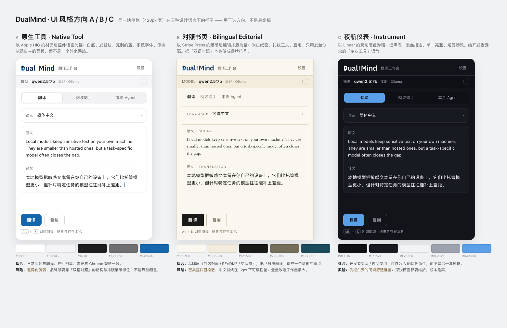
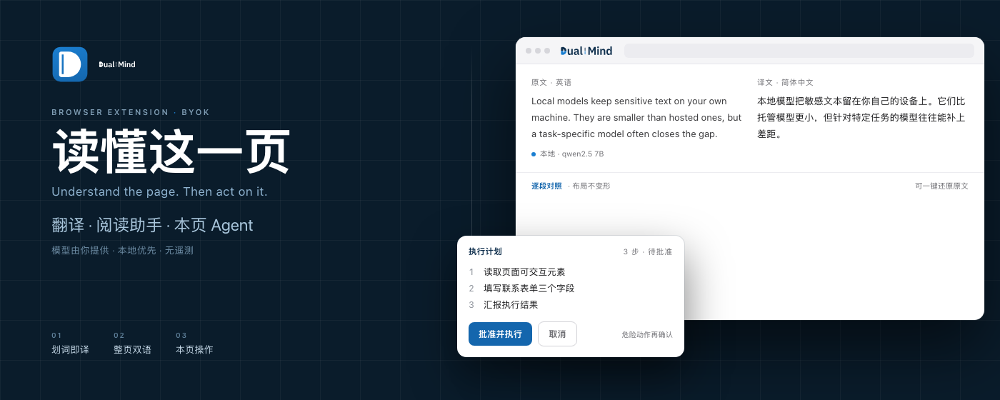
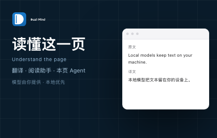
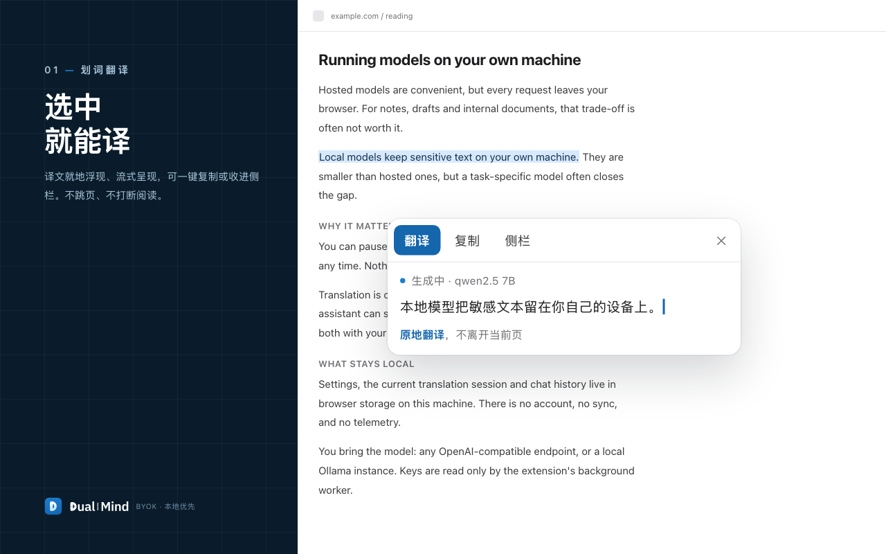
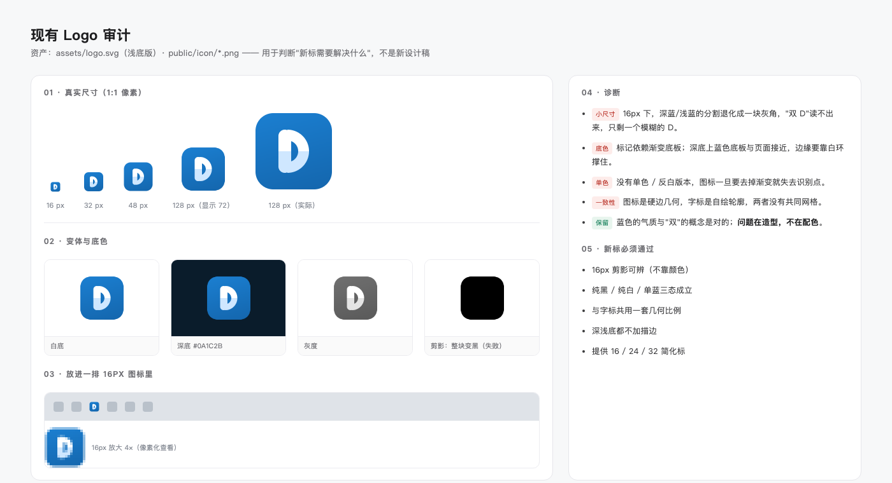
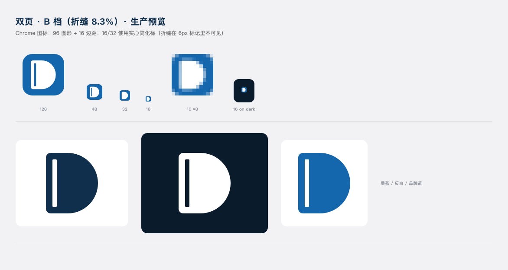

# DualMind UI 优化方案 v0.3（决策已定 · 含深色与设计工具接入）

> 状态：**进行中**（2026-10-18）：P0–P2、深色、P-FONT、P-LIB、P4 已落地；P3 商店截图待重拍。范围只覆盖 UI / 视觉层与 Chrome 商店素材，不改核心功能、消息协议与权限。
> 配套草图（可编辑）：**docs/assets/ui-refresh/mockups.html**（方向 / 封面 / 截图模板）、**logo-audit.html**（Logo 审计）；渲染产物见 **docs/assets/ui-refresh/**。
> 现有上架材料：[store-listing.md](./store-listing.md)、[store-screenshots.md](./store-screenshots.md)。
> 建议阅读顺序：§0 速览 → §3 选方向 → §4 设计 token → §6 商店素材；其余按需。

---

## 0. 一页速览

| 项 | 结论 |
|---|---|
| 主方向 | **A · 原生工具**（以 Apple HIG 的材质 / 控件语言为锚） |
| 辅助语汇 | B 的**排版**只用于商店封面、README、空状态；不作为第二套组件 |
| C 的定位 | 不作独立风格；深色按 A 的同一套 token 派生（本轮就做） |
| 应用内改动 | 13 项（全局 token / 字体 + 9 个界面区域 + 内容脚本 + 无障碍细节） |
| 商店素材 | 补齐 **440×280 小图（必填）** + **1400×560 marquee**；截图 **6 → 5 张**并统一加框 |
| 预估工时 | P0 2 天 · P1 1.5 天 · P2 0.5 天 · P3 1 天 · **深色 1 天** · 字体 0.5 天（单人，不含评审；Logo 视工具而定） |
| 最大风险 | 视觉改动无自动化回归基线；商店图必须用**正式包重拍**，否则宣传与实机不符 |

### 0.1 已确认的决策（2026-10-17）

| # | 决策 | 落地要点 |
|---|---|---|
| 1 | 方向 **A + B** | 应用内走 A（原生工具）；B 的排版语汇用于商店封面、README、空状态 |
| 2 | **内置 woff2 子集** | Latin 用 IBM Plex Sans（OFL），中文用 IBM Plex Sans SC 的 UI 字形子集；见 §4.2 |
| 3 | 深色模式**本轮一起做** | 与浅色共用一套语义 token，另出 dark 值；见 §4.5 |
| 4 | 封面**中英混排** | 已更新两张封面草图（"读懂这一页 / Understand the page…"），见 §6.2 |
| 5 | 截图**合并为 5 张** | 危险确认并入 Agent 计划那张；见 §6.3 |
| 6 | 新增工具**全部允许** | 合成脚本 + 图标库 + UI 组件库均可引入；具体选型与边界见 §9.1 |
| 7 | **Logo 需重新设计** | 见 §11：审计、参考规范、概念方向、交付物、工具方案；不用脚本硬画 |
| 8 | **设计工具** | 走 MasterGo 官方 MCP（客户端已内置本地 HTTP 服务）；见 §11.6 |
| 9 | 验证 | 选型与 P0 落地后，build / compile / test / e2e 全部跑一遍 |

> 注：截至 2026-10-18，P0–P2、深色、P-FONT、P-LIB、P4 已落地；本文保留方案推演，实际进度与验证见 §12。

**先说结论**：现在的问题不是"不够好看"，而是**没有层级**——37 处 rounded-xl、32 处 border-brand-100、30 处 11px 文本、49 处 text-xs，所有卡片、标签、按钮几乎同一个形状与重量；再加上品牌蓝被同时用作背景、描边、文字和状态，视觉上无法区分"这是什么、能不能点、现在什么状态"。这次优化的主线是**做减法 + 建层级**，而不是加新装饰。

---

## 1. 现状盘点（基于代码与截图）

### 1.1 视觉层

| 区域 | 位置 | 现状 |
|---|---|---|
| 全局 token | tailwind.config.js:8-27、assets/tailwind.css:5-15 | 只有一档 brand 色阶；页面底色 #f4f7fb、卡片一律 rounded-xl + border-brand-100 |
| 字体 | assets/tailwind.css:12、features/selection-toolbar/dom.ts:8、features/page-fab/dom.ts:174 | 三处都声明 IBM Plex Sans，但**从未加载**（无 @font-face、无 webfont 文件）。实际落到 PingFang / Segoe UI，品牌排版不可控 |
| 工作台头部 | features/translate/ui/WorkbenchApp.tsx:430-467 | 17px 字标 + 12px 70% 透明副标题 + 两个文字按钮，无分隔、无高度约束 |
| 模型横栏 | WorkbenchApp.tsx:472-491、ModelSelector.tsx:107-140 | 品牌色带 + 实心蓝胶囊（带 pulse 动画）+ 触发器蓝色强调，**三重强调**，抢走主内容注意力 |
| 模块 Tab | WorkbenchApp.tsx:494-525 | 侧栏是裸文字按钮、工作台是胶囊分段，两套形态；活动态是实心蓝块 |
| 翻译区 | WorkbenchApp.tsx:543-657 | 语言卡 + 原文卡 + 译文卡三层嵌套，textarea 自带边框套在卡片边框里；主按钮固定 w-44；空态只有 placeholder |
| 阅读助手 | features/chat/ui/ChatPanel.tsx:86-236 | 上下文卡 + 三条同权重按钮；11px 元信息、brand-700/50 的绑定页；消息区无气泡层级 |
| 本页 Agent | features/agent/ui/AgentPanel.tsx:62-231 | 计划卡是蓝底大块；时间线整行改文字色；10px 的 kind 标签；危险卡用 amber 大面积铺底 |
| 设置页 | entrypoints/options/App.tsx:201-218、484-503 | 背景是径向蓝渐变（radial-gradient(100% 80% at 10% 0%, …)）；单列长卡；保存按钮埋在页面底部，无 sticky |
| 划词浮层 | features/selection-toolbar/dom.ts:2-87 | 白→浅蓝渐变底、4 个等宽按钮（翻译/复制/侧边栏/关闭）、12px 圆角 |
| 沉浸译译文块 | features/immersive/renderer.ts:28-60 | **3px 左色边 + 浅蓝底**——正是设计规范里点名的"圆角卡片 + 左侧色边"反模式 |
| 页面悬浮入口 | features/page-fab/dom.ts:150+ | 交互与几何已很讲究（贴边把手、注意力透明度），但配色/阴影自成一套，与主界面漂移 |

### 1.2 可量化的两个硬问题

**（1）对比度**（WCAG 2.1，正文需 ≥ 4.5:1）

| 当前用法 | 实际色值 | 对比度 | 结论 |
|---|---|---|---|
| 主按钮：白字 / bg-brand-500 | #FFFFFF on #1B7FD1 | **4.20** | 13–14px 未达 AA |
| 链接/按钮文字：text-brand-600 | #1466AD on #FFFFFF | 5.94 | 可用 |
| 副标题 brand-700/70 | 合成 #5986AE | **3.86** | 未达 AA |
| 设置页提示 brand-700/60 | #7197BA | **3.07** | 未达 AA |
| Agent 元信息 brand-700/55 | #7DA0C0 | **2.74** | 未达 AA |
| 分隔/装饰 brand-700/40 | #A0BAD1 | **2.01** | 仅可作纯装饰 |

> 处理：文字用**实色中性灰**（#6E6E73 = 5.07:1）替代透明度蓝；交互蓝统一到 #1466AD（5.94:1）；#1B7FD1 只用于图标、描边、指示点等 ≥3:1 的非文本元素。

**（2）商店缩略图**

Chrome 会把 1280×800 截图**降采样到 640×400** 展示。当前截图里的 UI 正文是 11–14px，缩到一半即 **5–7px**，实际不可读；六张图都是裸视口，没有标题、没有品牌框，缩略后只剩"一片浅蓝白"。

### 1.3 商店素材现状

| 项 | 现状 | 官方要求 | 影响 |
|---|---|---|---|
| 小宣传图 | 仓库内无对应素材（docs/assets 下只有 6 张截图） | **440×280 必填** | 缺图会排在"有小图"的扩展之后 |
| Marquee | 无 | 1400×560，选填（争取首页轮播才需要） | 无 |
| 截图数量 | 6 张 | **最多 5 张** | 必须合并或删减 |
| 截图尺寸 | 1280×800 ✔ | 1280×800 或 640×400，直角、全出血 | 尺寸合规，但内容缩略后不可读 |
| 截图说明 | 写在 docs/store-screenshots.md | 每张配说明 | 图内无标题，落地页信息靠商店文案补 |

---

## 2. 参考体系（开源 skill / 官方规范）

这次不"凭感觉调"，按现成的开源方法与硬规范来做。

| 来源 | 是什么 | 我们取什么 |
|---|---|---|
| [ConardLi/garden-skills · web-design-engineer](https://github.com/ConardLi/garden-skills) | 面向 AI 编程代理的设计 skill：六步工作流、25 个"风格配方"（Linear / Aesop / Stripe Press / Apple HIG…）、反 AI 味清单、redesign 协议 | **主参考**：① 按它的 Redesign · Preserve 模式做（保留信息架构与交互契约，只换视觉词汇）；② 用配方里的**具象色板 / 字阶 / 圆角 / 阴影**，避免"Inter + #3b82f6"式默认；③ 用反模式清单自检 |
| [nextlevelbuilder/ui-ux-pro-max-skill](https://github.com/nextlevelbuilder/ui-ux-pro-max-skill) | 57 种 UI 风格 + 设计系统生成器（模式 / 配色 / 字体 / 反模式） | 生成 A/B/C 候选 token 时的交叉参考；不引入其代码 |
| [anthropics/skills](https://github.com/anthropics/skills) | 官方 skill 示例集，含 theme-factory（10 套主题）、canvas-design（海报 / 静态视觉） | 商店封面 / README 配图的主题与构图参考 |
| [vercel-labs/web-interface-guidelines](https://github.com/vercel-labs/web-interface-guidelines) | 框架无关的界面细则（焦点、表单、动效、可访问性） | 逐条当验收 checklist，尤其是 focus-visible、点击区、prefers-reduced-motion |
| [Chrome · Supplying Images](https://developer.chrome.com/docs/webstore/images) / [Creating a compelling listing](https://developer.chrome.com/docs/webstore/best-listing) | 官方素材规格与建议 | 尺寸、数量、全出血、文案合规的**硬标准** |

> 采集这些外部资料时走的是本机代理（SOCKS5 127.0.0.1:1080）；材料只作设计参考，不引入任何运行时依赖。

**选定的工作模式（来自 garden-skills 的 redesign 协议）**：这是 **Redesign · Preserve**，不是 Overhaul——保留 Tab 结构、上下文卡、计划批准流程、危险确认的两步路径；只改材质、排版、层级、状态表达。这样可以分区域小步替换，随时可回滚。

---

## 3. 三个方向（图 + 取舍）

三张草图都是同一块 **420px 侧栏**、同一段中英对照内容，只换设计语言——便于直接比较"层级、密度、气质"的差异。

| | A · 原生工具 | B · 对照书页 | C · 夜航仪表 |
|---|---|---|---|
| 锚点 | Apple HIG | Stripe Press | Linear |
| 底色 | #FFFFFF / #F5F5F7 | #FAF7F0 暖纸 | #0F1115 近黑 |
| 主文字 | #1D1D1F | #1A1A18 | #F2F3F5 |
| 次要文字 | #6E6E73 | #736D5A | #9CA3AF |
| 强调色 | #1466AD（品牌蓝） | #1B4B5A 墨青 | #5AA0E8 亮蓝 |
| 字号 | 系统字体；14/22 正文 | 衬线标题 + 衬线正文 | 系统 / Inter |
| 圆角 | 10 / 14 / 18 | 0–3（直角） | 8 / 12 |
| 阴影 | 几乎不可见 | 无 | 无（faint） |
| 气质 | 像浏览器自带面板 | 像一本可对照的书 | 像一台专业工具 |
| 主要风险 | 差异化偏弱 | 密集控件显松散，中文衬线小字号可读性差 | 侧栏白天阅读舒适度差；深浅两套维护成本高 |
| 工作量 | **S–M** | L | M–L（且要另做一套 dark token） |

**推荐 A**，理由：

1. **场景匹配**：侧栏是"边读边操作"的窄面板，需要的是密度、清晰、不打扰，而不是氛围。
2. **可逆、低风险**：只换材质与排版，不动结构；每个区域可独立上线。
3. **可访问性容易达标**：白底 + 实色灰 + 深蓝，对比度天然可控（见 §4）。
4. **与 Chrome 原生一致**：扩展面板最怕"像一张嵌进去的网页"，A 的材质语言最不像外来页面。

**B 的用法**：把它的排版语汇（大字号、宽字距、发丝线、编号 01/02/03）用到**商店封面、README、空状态插画位**——这些是"讲故事"的地方，而不是控件密集区。这样既拿到品牌辨识度，又不牺牲面板可用性。

**C 的用法**：不单独做；若将来要深色，用 A 的 token 派生一套 dark 值（同一套结构、同一套层级），成本可控。

---

## 4. 设计 token（可直接落 tailwind.config.js）

### 4.1 颜色

| token | 值 | 用途 | 对比度（白底） |
|---|---|---|---|
| canvas | #F5F5F7 | 页面 / 工作台底色 | — |
| surface | #FFFFFF | 卡片、面板 | — |
| surface-2 | #FAFAFC | 次级面（输入框、代码、空状态） | — |
| line | #E6E6EB | 发丝分隔 | — |
| line-strong | #D2D2D7 | 控件描边 | — |
| ink | #1D1D1F | 主文字 | 16.83 ✔ |
| ink-2 | #6E6E73 | 次要文字（替代所有 brand-700/xx） | 5.07 / 4.66（canvas）✔ |
| ink-3 | #8E8E93 | 仅装饰 / 禁用 | 3.3（不承载正文） |
| accent | #1466AD | 按钮底、链接、选中 | 5.94 ✔ |
| accent-hover | #12528C | hover / pressed | > 5.94 ✔ |
| accent-soft | #EAF3FB | 选中底、focus 外圈、tag | — |
| brand-mark | #1B7FD1 | **只用于** logo / 标记、指示点、2px 描边 | 4.20（≥3 图形可用） |
| success | #0B7A53 | 成功态文字 | 5.35 ✔ |
| warn | #B25000 | 警告态文字 | 5.20 ✔ |
| danger | #C4342D | 危险 / 错误文字 | 5.42 ✔ |

> 语义色**不铺大面积底**：浅底 + 深字（例如 warn 用 #FFF8EC 底 + #B25000 字），避免整块 amber / red 造成"整屏报警"。

### 4.2 字体与字阶

先做一个**决策**（见 §9 问题 2）：

**已定：内置 woff2 子集。** 落地方式：

| 项 | 方案 |
|---|---|
| 拉丁 | IBM Plex Sans（OFL 许可，可随包分发），400 / 500 / 600 三个字重，只取 latin 子集 |
| 中文 | IBM Plex Sans SC（OFL）的**界面字形子集**：只收 UI 文案里实际出现的字 + 常用标点/数字，约 300–400 字 |
| 不进入子集的 | 模型返回的译文/摘要正文（任意汉字），由系统字体兜底——不会因缺字出现豆腐块 |
| 体积预算 | Latin 三档 ≈ 55–70KB；中文子集 ≈ 150–250KB；合计 **≤ 320KB**（gzip 后更小） |
| 加载 | font-display: swap；woff2 放 public/fonts/；CSS 用 @font-face + unicode-range；首屏 preload 只预载 400 字重 |
| 兜底栈 | "IBM Plex Sans", "IBM Plex Sans SC", "PingFang SC", "Microsoft YaHei", system-ui, sans-serif |
| 合规 | 仓库内附 OFL 许可证副本（LICENSES/IBM-Plex-OFL.txt），并在 README「致谢」列出 |
| 生成 | 用 pyftsubset 从官方 TTF/OTF 生成子集；子集脚本与字符清单入库，便于文案变化后重建 |

> 已定细节：中文只做 400 / 600 两档（省体积）；中文子集只覆盖 UI 文案，不覆盖商店文案；商店封面由同一字体渲染时按字形回退处理。

| 角色 | 字号 / 行高 | 字重 | 用途 |
|---|---|---|---|
| display | 20/28 | 600 | 空状态、封面 |
| title | 16/24 | 600 | 区块标题、Tab |
| body | 14/22 | 400 | 默认 UI 文本 |
| body-strong | 14/22 | 500 | 按钮、强调行 |
| reading | 15/26 | 400 | 原文 / 译文、消息正文 |
| label | 12/18 | 500 | 字段名、Tab 副标、chip |
| meta | 11/16 | 400 | 仅计数 / 时间等非关键信息（**不再承载操作**） |
| mono | 12/18 | 400 | host、模型名、代码 |

中文行高不低于 1.55；数字用 tabular-nums（步数、段数、耗时）。

### 4.3 间距 / 圆角 / 阴影 / 动效

| 类别 | 值 |
|---|---|
| 间距 | 4 / 8 / 12 / 16 / 20 / 24 / 32（4pt 基准；侧栏卡片内 12，工作台 16） |
| 圆角 | 18 面板 · 14 卡片 · 10 控件 · 6 chip（**不再全站 12**） |
| 阴影 | 卡片 0 1px 2px rgba(0,0,0,.04)（深色自动换 1px 描边）；浮层 0 12px 32px rgba(15,23,32,.14)，无彩色投影 |
| 描边 | 1px line；浮层可用 0 0 0 1px rgba(15,23,32,.06) 替代第二层阴影 |
| 动效 | hover 120ms、状态 180ms、面板 240ms，cubic-bezier(.22,1,.36,1)；prefers-reduced-motion 下全部降为 0 |
| 焦点 | outline: 2px solid #1466AD; outline-offset: 2px（或 box-shadow: 0 0 0 3px #EAF3FB） |

### 4.4 迁移策略

1. **先加不删**：在 tailwind.config.js 增加 colors.ink/canvas/surface/line/accent.*、boxShadow.card/popover、borderRadius.card/control。
2. 按区域替换类名（§5 顺序），brand-* 逐步只在 logo / 品牌位出现。
3. 不改任何 data-testid、不改组件 props、不改消息与 storage——纯样式层可随时回退。

### 4.5 深色模式（本轮一起做）

**策略**：同一套语义 token，两套值。组件只写 `bg-surface text-ink border-line`，不写具体色值；通过 `html[data-theme="dark"]`（或 `.dark`）切换 CSS 变量。默认跟随系统 `prefers-color-scheme`，设置页提供「跟随系统 / 浅色 / 深色」三选一。

| token | 浅色 | 深色 | 说明 |
|---|---|---|---|
| canvas | #F5F5F7 | #121418 | 工作台/设置页底 |
| surface | #FFFFFF | #1A1D23 | 卡片、面板 |
| surface-2 | #FAFAFC | #21252C | 输入框、次级面 |
| line | #E6E6EB | #2B3038 | 发丝分隔 |
| line-strong | #D2D2D7 | #3A404A | 控件描边 |
| ink | #1D1D1F | #F2F3F5 | 主文字 |
| ink-2 | #6E6E73 | #A6ADB8 | 次要文字（深底对比 ≥ 7:1） |
| ink-3 | #8E8E93 | #8A93A2 | 仅装饰/图标；深色版按 WCAG 提到 ≈5.2:1（原 #6B7280 仅 3.49:1） |
| accent | #1466AD | #6FAEEC | 深色下换更亮的蓝，保证 4.5:1 以上 |
| accent-soft | #EAF3FB | #1B2A3A | 选中/悬停底 |
| success / warn / danger | #0B7A53 / #B25000 / #C4342D | #3DD68C / #F0B25B / #F2777A | 深色版需单独测对比度 |

**落地要点**：

- 深色不靠"反色滤镜"：每对前景/背景都按 WCAG 重新算，不以"看起来还行"为准；品牌蓝在深底上必须提亮（#1466AD 在 #121418 上只有 ~3.0:1，不能直接用）。
- 阴影在深色下几乎无效，改用 1px 描边 + 表面色差表达层级。
- 内容脚本三处（划词浮层 / 悬浮入口 / 沉浸译）跟随**扩展的**主题，不跟随宿主页面；沉浸译译文块按 `prefers-color-scheme` 适配宿主页面（页面可能是深色）。
- 图片与模型图标（providers 的 SVG）在深色下检查是否需要反白；不得用滤镜整体反色。
- 验收：浅/深两套各自跑一遍对比度与 640×400 缩略检查；商店截图仍只用浅色（与实机一致，不为深色另拍）。

---

## 5. 组件级改动清单

> 工作量：S ≤ 0.5 天，M ≈ 0.5–1 天，L > 1 天。所有行号对应当前代码。

| # | 区域 | 位置 | 现状 → 改法 | 量 |
|---|---|---|---|---|
| 1 | 全局 token | tailwind.config.js:8、assets/tailwind.css:5 | 单色阶 + 蓝灰底 → 语义 token（§4）；body 背景改 canvas，文字改 ink | S |
| 2 | 字体 | tailwind.css:12、selection-toolbar/dom.ts:8、page-fab/dom.ts:174 | 三处统一为一个常量 / 一份 CSS 变量；按 §9 问题 2 的决策替换 | S |
| 3 | 工作台头部 | WorkbenchApp.tsx:430-467 | 固定 56px 高；字标 18px；副标题 ink-2 12px，用 · 分隔；右侧改"图标 + 文字"的 ghost 按钮；工作台加 1px 底线 | S |
| 4 | 模型横栏 | WorkbenchApp.tsx:472-491、ModelSelector.tsx:107-140 | 去掉品牌色带与 pulse 胶囊；白底 + 底线；左侧 12px "模型" + 14px 模型名（600）+ 12px "本地 · Ollama"；右侧只有刷新图标；**只保留一处强调** | S |
| 5 | 模块 Tab | WorkbenchApp.tsx:494-525 | 统一为一种：侧栏用紧凑 segmented（surface-2 底 + 活动项白底 + shadow-card），工作台用下划线 tab；活动态不再用实心蓝块；文案"网页助手"→"**阅读助手**"（与商店文案一致） | S |
| 6 | 翻译区 | WorkbenchApp.tsx:543-657 | 三卡合并为一张卡，内部用 1px line 分隔；textarea 去掉自身边框（focus 时整卡 ring）；主按钮自适应内容宽、放右下；空状态给"粘贴文本 / Alt+K 划词"两个入口；译文字号 15/26 | M |
| 7 | 阅读助手 | ChatPanel.tsx:86-236 | 上下文卡压成一行 chip（范围 + 段数 + 重新读取）；三枚按钮做主次（总结为主，新对话 / 历史为 ghost）；助手消息不复用卡片样式，用户消息用 surface-2 圆角块；空状态给 3 个建议提问 | M |
| 8 | 本页 Agent | AgentPanel.tsx:62-231 | 计划卡改白卡 + 步骤编号列表（**去掉左色边**），按钮吸底；时间线用 12px 图标 + 文字，不再整行改色；危险卡浅底深字，"跳过"在左、"仍要执行"在右（危险动作用 danger）；顶部状态改 chip | M |
| 9 | 设置页 | options/App.tsx:201-218、484-503 | 去掉径向蓝渐变背景，改 canvas；分区标题（模型 / 翻译 / 站点 / Agent / 关于）；保存条 sticky 在底部，状态就近显示；输入统一 40px 高 + focus ring | M（可选左导航 → L） |
| 10 | 划词浮层 | selection-toolbar/dom.ts:2-87 | 白→蓝渐变改纯白；4 个等宽按钮改"1 主 + 3 图标"；圆角 10、阴影用 shadow-popover；loading 改顶部 2px 进度条；宽度 300 | M |
| 11 | 沉浸译译文块 | immersive/renderer.ts:28-60 | 去掉 3px 左色边与浅蓝底；改"上间距 16px + 译文字号 .94em + ink-2"，让译文靠**排版**而非色块区分；未译 badge 改 warn 浅底深字 | S |
| 12 | 页面悬浮入口 | page-fab/dom.ts:150+ | **只换 token**（环色、阴影、字号），几何 / 贴边 / 注意力逻辑一律不动 | S |
| 13 | 无障碍细节 | 全局 | 承载操作的字号 ≥12px；点击区 ≥32px（侧栏）/ 40px（工作台）；所有可聚焦元素有 focus-visible；tabular-nums；prefers-reduced-motion | S |

**明确不改**：Tab 数量与顺序、上下文卡的信息项、计划批准与危险确认的流程、任何 data-testid、任何消息 / 存储字段、消息协议与 storage 结构。

**新增（按"全部允许"）**：

| # | 新增项 | 选型建议 | 边界 |
|---|---|---|---|
| 14 | 图标库 | Lucide（tree-shaking 后按需、可内联 SVG）；内容脚本按需内联，不整包引入 | 只用于 UI 图标；品牌标记继续用自有 SVG |
| 15 | UI 组件库 | Radix Primitives（无样式、可访问性好）+ 本地 shadcn 风格封装；只为 Select / Dialog / Tooltip / Popover 这类"交互原语"引入 | 不引入整套设计系统皮肤；现有 `SearchableSelect`/`SegmentedControl` 先保留，逐步替换；每引入一个原语先在侧栏验证键盘与焦点 |
| 16 | 深色模式 | 工具类 + CSS 变量（§4.5）；设置页三选一 | 不做主题市场、不做自定义配色 |

> 依赖代价：Radix 单包 gzip 后约 10–20KB（按原语计），Lucide 按需引入通常 < 10KB；需在 PR 里报告打包前后体积。

---

## 6. Chrome 商店素材方案

### 6.1 硬规格（官方）

| 素材 | 尺寸 | 要求 |
|---|---|---|
| 扩展图标 | 128×128 PNG（视觉安全区约 96×96） | 已在 public/icon/，本轮不动 |
| **小宣传图** | **440×280** | **必填**；会出现在首页 / 分类 / 搜索结果 |
| Marquee | 1400×560 | 选填；争取首页轮播才需要 |
| 截图 | 1280×800 或 640×400，**最多 5 张** | 直角、全出血、无透明；展示真实体验 |

官方设计建议（摘要）：**少文字、别太满、缩到一半仍要能看懂、用饱和色、避免大面积白 / 浅灰、填满画布、边缘清晰、与图标 / 截图品牌一致**。

### 6.2 封面（小图 + marquee）

**构图**（两张同源，便于维护）：

- 底色用**品牌深蓝 #0A1C2B**（不是白底）——既满足"饱和、避免大白"的官方建议，也和 brand-900 同源，与图标、截图不脱节。
- 左侧：标记 + 字标 → 眉标（BROWSER EXTENSION · BYOK）→ 主标题 → 副标 → 一行小字。
- 右侧：**产品本体作为主视觉**（浏览器窗口 + 一段真实中英对照），再用一张"执行计划"浮卡点出第三个能力；marquee 底部补 01/02/03 三个编号卖点。
- 小图去掉编号与细字，只留：标记 + "读懂这一页" + 副标，保证缩到 220×140 仍可读。

**文案（草稿，可直接替换）**

| 位置 | 中文 | English（同一张图内混排） |
|---|---|---|
| 主标题 | 读懂这一页 | —（中文为主标题） |
| 英文副标 | — | Understand the page. Then act on it. |
| 中文副标 | 翻译 · 阅读助手 · 本页 Agent | — |
| 角标 | 模型由你提供 · 本地优先 · 无遥测 | BYOK · local-first · no telemetry（小图可省） |
| 三点（仅 marquee） | 01 划词即译 / 02 整页双语 / 03 本页操作 | — |

备选主标题："**先读懂，再动手**"（更强调 Agent）；"**这一页，交给你的模型**"（更强调 BYOK）。三选一即可，不建议再长。

**中英混排规则**（已按此更新两张封面）：

- 中文承担**主张**（主标题），英文承担**语气/调性**（副标），不重复同一句话；
- 英文行字号约为主标题的 1/4，加宽字距（.04em），颜色比中文副标更暗一档，形成"主—辅—辅"的层级；
- 中英不挤在同一行里；如必须同行，中英文之间留 1/4 字宽空隙；
- 小图（440×280）只保留 5–7 个词的英文行；缩到 220×140 时允许英文行不可读，但**主标题必须可读**。

### 6.3 截图（6 → 5 张）

统一模板：**左 330px 文案列（深色底）+ 右侧真实 UI**，UI 按场景放大 1.5–1.8× 并裁到关键区域；不铺满整屏，避免缩略后全是小字。

| # | 文件 | 卖点 | 画面主体 | 图内文案 |
|---|---|---|---|---|
| 1 | 01-selection-toolbar.png | 划词翻译 | 选中句 + 浮层（1.5×） | 选中就能译 |
| 2 | 02-immersive-fullpage.png | 整页双语 | 正文对照段（含未译 badge） | 原文不动，译文跟上 |
| 3 | 03-workbench-translate.png | 工作台 | 双栏工作台（1.2×，裁关键区） | 长文，在工作台里译 |
| 4 | 04-reading-assistant.png | 阅读助手 | 摘要 + 追问 | 先总结，再追问 |
| 5 | 05-agent-plan.png | 计划批准 | 计划卡 + 危险确认（同屏双卡） | 先给你看计划 |
| — | ~~06-agent-danger-confirm.png~~ | 危险确认 | **合并进 #5** | — |

> 合并方式：同屏呈现"计划卡 + 危险确认卡"（高度压缩、各占一半），或左右双联。既守住"危险动作二次确认"的披露，又把数量压到 5 张。

**每张的验收标准**：缩到 640×400 后——① 标题可读；② 至少一个 UI 元素可辨认；③ 不出现任何虚构数据 / 夸大表述；④ 与图标、封面同一套品牌色。

### 6.4 可复现的生成方式

不建议手工 PS，理由是下一版 UI 一改，图就作废。建议：

1. **采集**：沿用 e2e/store-screenshots.e2e.ts（已支持 DM_CAPTURE=1、指定正式包、锁 devicePixelRatio=1），只产出**原始 UI 截图**。
2. **合成**：新增一个纯模板脚本，把原始截图放进 §6.3 的框里，输出最终 1280×800。模板就是本次的 docs/assets/ui-refresh/mockups.html（可编辑、纯 HTML/CSS）。
3. **封面**：同一份 HTML 里维护 440×280 与 1400×560 两个 section，改文案只改一处。
4. **产物入库**：docs/assets/store/（截图）+ docs/assets/store/promo/（封面），README 同步引用。

> 合成脚本属于新增文件（不改功能），按仓库约定需要你点头；也可以先手工用这份 HTML 出图，等 UI 定稿再脚本化。

---

## 7. 分阶段实施与验收

| 阶段 | 内容 | 产出 | 验收 |
|---|---|---|---|
| **P0** 2 天 | token 底座 + 头部 / 模型栏 / Tab / 翻译区 | 侧栏与工作台主路径换新 | 截图前后对比；对比度 ≥4.5；主按钮白字达标 |
| **P1** 1.5 天 | 阅读助手 + Agent + 空 / 错 / loading 三态 | 两个 Tab 与新视觉一致 | 计划批准、危险确认两步流程不变；键盘可达 |
| **P2** 0.5 天 | 划词浮层 + 沉浸译 + 悬浮入口换 token | 页面内三处与面板同源 | 划词、停止、复制、还原等手测路径通过 |
| **P3** 1 天 | 封面 2 张 + 截图 5 张 + README 更新 | 可直接上传的素材 | 640×400 缩略检查；尺寸 / 数量 / 文案合规 |
| **P-FONT** 0.5 天 | 下载 IBM Plex（OFL）、生成子集、接 @font-face、附许可证 | public/fonts/ + 子集脚本 + 字符清单 | 体积 ≤320KB；缺字回退不出现豆腐块 |
| **P-LOGO** 待工具确认 | 图标重设计（§11）：方向 → 网格 → 定稿 → 全尺寸导出 → 替换 icon 与字标 | 主标 / 简化标 / 组合标 / 规范页 | 16px 剪影测试；深浅底；单色；与字标同网格 |
| **P-DARK** 1 天 | 深色 token + 设置页三选一 + 三处内容脚本适配 | 浅/深两套可用 | 两套各自跑对比度；深色下品牌蓝提亮后 ≥4.5 |
| **P-LIB** 0.5 天 | 引入 Lucide 图标 + Radix Select/Dialog 原语（逐步替换） | 组件依赖清单 + 体积报告 | 键盘/焦点回归；打包体积增量如实报告 |
| **P4** 可选 2–3 天 | 设置页左导航 | 增强项 | 单独排期，不阻塞发布 |

**推荐验证顺序**（每阶段结束都做）：

1. 逐屏截图对比（旧 vs 新），确认层级变化符合预期；
2. 对比度脚本（临时 _tmp-*，用完即删）：扫描文字色 / 背景色对，断言 ≥4.5；
3. 640×400 缩略检查（商店图必做）；
4. 手测路径：划词翻译 → 收进侧栏 → 沉浸译 → 阅读助手总结 → Agent 计划批准 → 危险确认跳过；
5. 单元 / E2E 按你的决定**全部执行**：build / compile / test / e2e（e2e 需本机 Ollama 与 build 产物）；在 P0 首次落地后作为回归基线。

---

## 8. 风险与回滚

| 风险 | 说明 | 对策 |
|---|---|---|
| 视觉回归无基线 | 现在没有截图快照 | P0 开始时先存一份"改前"截图作为基线 |
| 类名替换影响测试 | E2E 主要靠 data-testid 与文案 | 不动 testid；唯一改文案处（"网页助手"→"阅读助手"）需同步检查文本断言 |
| 商店图与实机不符 | 宣传图容易被要求"与最新版本一致" | 截图必须用**正式包**重拍；合成只加框，不改 UI 内容 |
| 深色维护成本 | 两套主题意味着每个新组件都要验两种底色 | token 只允许语义色；新增组件必须同时过浅/深对比度；截图基线存两套 |
| UI 库引入破坏一致性 | Radix/shadcn 的默认样式会与手写控件不一致 | 只用无样式原语；所有样式走同一套 token；逐个原语替换、不批量重写 |
| 范围蔓延 | 设置页左导航、动效等"顺手就能做" | 留 P4；深色与图标/组件库已按你的决定纳入 |
| 字体子集不完整 | 中文子集只覆盖 UI 文案；模型返回的正文若含生僻字会回退系统字体，可能轻微跳变 | 子集字符清单入库、文案改动后重建；正文显式走系统字重栈，避免逐字回退 |
| 字体体积失控 | 子集过大拖慢首屏 | 预算 ≤320KB，超了先砍字重（400/600 两档）再砍字形 |
| Logo 阻塞整体 | 图标重设计依赖工具/账号，可能拖到 P3 之后 | UI 与商店素材用现有图标先行；新标定稿后一次性替换，互不阻塞 |

---

## 9. 决策状态与剩余待确认

| # | 问题 | 状态 | 结论 |
|---|---|---|---|
| 1 | 方向 | ✅ 已定 | A + B（B 只用于封面 / README / 空状态） |
| 2 | 字体 | ✅ 已定 | 内置 woff2 子集（§4.2） |
| 3 | 深色模式 | ✅ 已定（变更） | 本轮一起做（§4.5 / P-DARK） |
| 4 | 封面语言 | ✅ 已定 | 中英混排，规则见 §6.2 |
| 5 | 截图数量 | ✅ 已定 | 6 → 5，危险确认并入 Agent 计划 |
| 6 | 新增工具 | ✅ 已定（变更） | **全部允许**：合成脚本 + 图标库 + UI 组件库（边界见 §5） |
| 7 | Logo | 🆕 新增 | 见 §11 |
| 8 | 设计工具 | ⚠️ 待联调 | 走 MasterGo 官方 MCP；客户端已内置，见 §11.6 |
| 9 | 验证 | ✅ 已定 | 代码落地后 build / compile / test / e2e 全部执行 |

### 9.1 三个待办（不需要你做设计决策）

**（a）MasterGo MCP 联调**（关键路径）

我已经从本机数据里确认：MasterGo 客户端（1.11.7）**自带 MCP 服务**，不需要另装 `@mastergo/vibe-mcp`：

- 组件：`mastergo-mcp` v1.0.31，托管在 `~/Library/Application Support/master-desktop/local-ai-canvas/mastergo-mcp/`
- 端点：`http://127.0.0.1:20678/mcp`（HTTP transport，健康检查 `/health`；端口可能变化，以 `runtime.json` 为准）
- 联调结果（2026-10-18 15:38）：客户端已启动，`20678`（MCP）与 `30678`（画布桥）均监听；`/health` 返回 ok；`initialize` 成功；`tools/list` 返回 **24 个工具**

当前卡点：调用只读工具返回 **"no online mg canvas"** —— 客户端里**还没有打开设计文件**，所以画布未连接。下一步只需在 MasterGo 里打开任意一个设计文件（新建空白文件即可），再重测：
1. `get_variables` / `get_selection_node` 正常返回 → 账号可用；
2. 若返回 401/403/额度不足/会员限制 → 才需要开通会员或 AI 额度；
3. 用空白文件调一次 `design_page`，可确认 AI 生成是否被会员门槛拦住。

**（b）MasterGo 会员判断**

- 公开定价页只区分**初创版（免费）/ 团队版 / 企业版**；免费版限制是：个人草稿 10 个文件、单文件 3 页、1 万图层。
- 定价页没有写 MCP 的计费方式；MCP 属于 AI 能力，**大概率消耗 AI 额度或需要团队版**——但这只是推断，必须用 (a) 的实际调用来确认。
- 我们的用量很小（1 个 Logo 文件 + 1 个 UI 板），即便免费版也够用；真正可能的卡点是 **AI/MCP 权限**，不是文件数。

**（c）"全部运行"的落地**

按"允许全部新增"执行：合成脚本 + Lucide 图标 + Radix 原语（见 §5）。验证则等 P0 代码落地后一次性跑 build / compile / test / e2e（e2e 需本机 Ollama 与 build 产物）。

---

### 9.2 Logo 工具结论（更新）

MasterGo MCP 可用后，Logo 不再是"只能出 brief"：可以直接在 MasterGo 画布里生成/修改矢量图形，导出 SVG/PNG，再由我接进 `assets/` 与 `public/icon/`。仍遵守"不写脚本硬画 logo"——**图形在 MasterGo 里做，代码只负责接入与验收**。

---

## 10. 本方案产出的文件

| 文件 | 说明 |
|---|---|
| docs/ui-refresh-plan.md | 本文 |
| docs/assets/ui-refresh/mockups.html | 可编辑草图（三方向 + 两张封面 + 截图模板），改文案 / 配色后可直接重拍 |
| docs/assets/ui-refresh/directions.png | 三方向对比板（1560×1010） |
| docs/assets/ui-refresh/cover-1400x560.png | Marquee 封面提案 |
| docs/assets/ui-refresh/cover-440x280.png | 小宣传图提案（必填素材） |
| docs/assets/ui-refresh/screenshot-template-1280x800.png | 截图统一模板示例 |
| docs/assets/ui-refresh/logo-audit.png | 现有 Logo 审计板（尺寸 / 灰度 / 剪影 / 16px 同行） |
| docs/assets/ui-refresh/logo-audit.html | 审计板源文件 |

> 说明：草图为**设计提案**，用 HTML/CSS 近似还原，不是最终像素稿；正文里提到的问题与数值均来自当前代码与官方文档。

---

## 11. 品牌标识（Logo）重设计

> 你补充要求：logo 重新设计；**不要用脚本硬画**；参考优秀设计规范；可以调用其他设计工具。
> 结论先说：图形**在 MasterGo 画布里做**（走官方 MCP，见 §11.6），代码只负责接入与验收——不写脚本硬画。客户端已内置 MCP 服务，目前只差"打开客户端 + 开启 MCP"这一步联调。

### 11.1 现状审计

资产：[logo.svg](../assets/logo.svg)（浅色底）、[logo-mark-blue.svg](../assets/logo-mark-blue.svg)、[logo-lockup.svg](../assets/logo-lockup.svg)、[wordmark.svg](../public/wordmark.svg)、[icon/128.png](../public/icon/128.png) / [icon/16.png](../public/icon/16.png)。

> 审计结论：剪影测试直接失败——整块变成黑色方块，说明图形没有独立于底板的轮廓识别点；这也是 16px 下"双 D"消失的根因。新标必须先过剪影，再谈配色与概念。

| 问题 | 表现 | 影响 |
|---|---|---|
| 小尺寸丢失识别 | 128px 里"双 D"靠深蓝/浅蓝两块分割；缩到 16px 只剩一个模糊的 D，分割线糊成灰色角 | Chrome 工具栏 / 标签页图标是高频曝光位，等于白丢 |
| 依赖渐变底板 | 深色版底板 #1b7fd1→#1466ad、浅色版 #eef8ff→#d9eeff；换背景就要换一套 | 深浅底 / 单色印刷 / 商店封面都要另做，容易走样 |
| 图形语言与字标不统一 | 图标是硬边几何，字标是自绘轮廓曲线，二者没有共同的网格或笔画逻辑 | 并置时像两个品牌 |
| 缺少规范 | 没有单色版、反白版、最小尺寸、安全边距、竖版组合 | 每次用都要临时拼，横竖版不一致 |
| 中英混排无准备 | 只有拉丁字标，没有中文标或混排基线规则 | 封面/README 里只能手动对基线 |

### 11.2 参考规范（要遵守的硬约束）

| 来源 | 关键要求 | 对本案的约束 |
|---|---|---|
| [Chrome · Supplying Images](https://developer.chrome.com/docs/webstore/images) | 128×128 PNG；实际图形 96×96 居中；不要自加描边；避免大投影；正面视角；深浅底都要可用 | 图标必须自带对比，不能靠底板渐变 |
| [Apple HIG · App icons](https://developer.apple.com/design/human-interface-guidelines/app-icons) | 单一焦点、无透明、小尺寸优先、圆角由系统裁切 | 图形要在 16px 有"剪影级"辨识度 |
| [Material Symbols 设计原则](https://fonts.google.com/icons) | 24dp 网格、统一笔画粗细、光学对齐 | 若用线性符号，笔画/端点规则要统一 |
| IBM Plex（OFL） | 与 UI 同源的无衬线家族，含 SC 字形 | 字标若重绘，优先与 UI 字体同骨架，便于混排 |
| 响应式标识系统（大型品牌手册通行做法） | 主标 → 简化标 → 单字标 → favicon 四级 | 交付必须包含这四级，而不是一个 SVG 打天下 |

> 这里不引用"某个大师的 logo 教程"，只采用可执行的平台规范 + 品牌系统方法，避免把风格偏好当标准。

### 11.3 设计目标与约束

1. **16px 可辨**：把图标缩到 16px 仍能说出"这是什么形状"，不靠颜色区分。
2. **单色成立**：纯黑 / 纯白 / 单品牌蓝三种状态都成立，不依赖渐变与阴影。
3. **与 A 的方向同源**：几何、发丝、克制；不用 3D、不用光晕、不用圆角糖果。
4. **表达"双面/双语"但不直白**：不画两个字母 D 并排（太像字体样例），也不画对话气泡（太像聊天工具）。
5. **可组合**：图标 + 拉丁字标（横/竖）、纯图标（favicon/工具栏）、纯字标（页头）。
6. **中文名未定**：不强行造中文标；先做拉丁字标 + 图标，中文名确定后再补。

### 11.4 三个概念方向（文字 brief，待设计工具出图）

**方向 1 · 双页（Two Pages）**

- 造型：两个圆角矩形（一页原文、一页译文）错位叠合，重叠区留出负形，整体外轮廓读作一个 D。
- 含义：对照阅读；"同一页的两种语言"。
- 16px：叠合后的整体剪影仍是一个明确的 D，重叠缝可以省略（简化标）。
- 风险：容易落回"两个方块"的通用感；需要靠**错位比例**和**负形宽度**做出记忆点。

**方向 2 · 对折（Fold）**

- 造型：一条竖线（书脊/分栏）两侧各一个不对称半形，拼成方；对外轮廓是"半开的书页"。
- 含义：原文与译文并列；"一页对折成两栏"。
- 16px：竖线 + 两个实心半块，剪影最稳，缩小损失最小。
- 风险：可能被读成"书/文档"类通用图标，需要靠不对称比例区分。

**方向 3 · 引号（Quotes）**

- 造型：两个引号形（一个中文引号、一个英文引号）在方形网格里咬合，形成一枚"对话中的逗号对"。
- 含义：双语转述；"把一句话换一种语言说出来"。
- 16px：两个小元素容易糊；需要把引号做得更粗、更方。
- 风险：容易被认成笔记/引用类工具，与 Agent 能力关联弱。

> 三个方向都不直接画"D"，但都保留"D"的剪影兜底——这样既有概念，又能通过 16px 测试。选定后需要在设计工具里做 2–3 轮几何微调与网格校验。

### 11.5 交付物清单（定稿后）

| 交付 | 规格 |
|---|---|
| 主标 | SVG，品牌双色 + 单色黑 + 单色白三版 |
| 简化标 | 16/24/32 用的减笔版（去掉内部缝隙或细节） |
| 组合标 | 横版（图标 + 字标）、竖版（图标在上、字标在下）、纯字标 |
| 位图 | 16 / 32 / 48 / 128 PNG（Chrome 图标：96 图形 + 16 边距） |
| 场景 | 工具栏、商店列表、favicon、README 头图、社交头像 |
| 规范页 | 安全边距、最小尺寸、深浅底用法、禁用示例（拉伸/加描边/换色） |

### 11.6 工具与流程（走 MasterGo MCP）

**结论：走 MasterGo 官方 MCP，直接在画布里做，代码只做接入与验收。**

本机实测（2026-10-18）：

| 项 | 实测 |
|---|---|
| MasterGo 客户端 | 已安装 1.11.7（`com.electron.master-desktop`），登录态数据存在 |
| MCP 组件 | 客户端**自带** `mastergo-mcp` v1.0.31，无需另装 `@mastergo/vibe-mcp` |
| 端点 | `http://127.0.0.1:20678/mcp`（HTTP），健康检查 `/health`；端口每次启动可能变化，以 `local-ai-canvas/mastergo-mcp/runtime.json` 为准 |
| 当前状态 | **DSH 画布插件已装、工具已注册，画布仍未连**：sidecar `mgmcp-dsh` v1.3.7-dsh.1 跑在 30679（protocol 11）；`mastergo_canvas_status` 返回 `canvasConnected: false / wsClientNum: 0` |
| 可用工具（据官方说明） | 读选区、生成页面/组件、改节点、删节点、读写变量、同步本地 HTML 到画布、Diff 等 20+ 个 |

**接入卡点（2026-10-18 实测）**：

画布连接不靠"打开客户端"，而是靠**文件里的内部插件 `local-mcp`**——它把画布接到本机 `ws://localhost:30678`。实测结论：

- 帮助中心与前端包都确认该插件存在（`VUE_APP_LOCAL_MCP_PLUGIN_URL`、内置插件列表里 `name: "local-mcp"`），但**它不在插件市场里**，菜单名就是小写的 `local-mcp`（无图标），很容易漏看；
- 客户端首页与文件页都没有"自动连接"：`wsClientNum = 0`，画布桥日志无任何连入记录；
- 我还起了一个 protocol 11 的 DSH sidecar（`mgmcp-dsh`）做对照：它能正常起服务（`workspaceProtocolVersion: 11`），但同样在等画布连入（`wsClientNum: 0`），说明**卡点不在客户端版本，而在"页面侧没有连上来"**。

**下一步（按成功率排序）**：

1. 在文件里打开**插件菜单**（不是插件市场），找小写的 `local-mcp`；运行后再测；
2. 已验证：官方 DSH 画布插件 **已安装成功**（`@mastergo/dsh-canvas ^0.1.6`，写入 desktop profile；sidecar 自动起在 30679，protocol 11），但**画布仍连不上**——它同样在等"页面侧"连入，所以插件不是卡点本身；
3. **备选通道：Codify MCP**（市场可装插件 + 云端 MCP，绕开隐藏入口），见下；
4. 都不行 → 退回"你画、我接入"：你在 MasterGo 手绘三个方向，导出 SVG/PNG，我做像素级校对与代码接入。

**Codify MCP 评估（2026-10-18）**

| 项 | 结论 |
|---|---|
| 入口 | MasterGo 插件市场搜「Codify MCP」（14.6k 安装），**可正常安装**——不是隐藏入口 |
| 架构 | 插件在画布里运行 → 连云端；本地用 `@codify-ai/mcp-client`（npx）经 `https://mcp.codify-api.com` 与插件通信 |
| 认证 | `CODIFY_ACCESS_KEY`（`sk-...`），需要 Codify 账号 |
| 能力 | 读选中图层 / 生成页面 / 改删节点 / 变量 / 图表 / 前端代码 / 双向同步（10+ 工具） |
| 实测 | **已打通并出图**：`get_variables` 读到 `DualMind-logo-scratch`（documentId `206656985814597`）；已生成 v0 概念板（双页 / 对折 / 引号）与两轮双页细化板，选定**双页 · V3 折缝**方向 |
| 16px 实测 | 折缝宽度 A 10.8% / B 8.3% / C 6.7% 三档在 16px 下对比：A 左页偏细、B 折缝与左页最均衡、C 接近实心 D；产物见 `docs/assets/ui-refresh/logo-size-test.png`，建议 **B** |
| 隐私 | 设计稿与代码会经 Codify 云端，**不是本地闭环**；只用于 logo/UI 草稿可接受，但需你确认 |
| 成本 | 官方 FAQ：免费计划可生成 HTML/CSS；付费约 ¥35/月（设计系统/组件库等高级能力）。画布操作是否免费需实测 |

使用方式：装插件并在文件里运行 → 登录 Codify 拿 access key → 我用本地客户端连上，先 `get_selection_node` 验证，再走 `design_page` 画三个方向。

**会员判断**：官方定价页只写了初创版（免费）/ 团队版 / 企业版，免费版限制是"个人草稿 10 个文件、单文件 3 页、1 万图层"；**没有写 MCP 如何计费**。MCP 属于 AI 能力，可能消耗 AI 额度或要求团队版——这一点必须用第 3 步的实际调用确认，我不先下结论。

**如果 MCP 被会员拦住**，退路：

| 退路 | 说明 |
|---|---|
| 你手动在 MasterGo 画 | 我提供网格、比例、验收清单，并对导出结果做像素级校对 |
| 团队版试用 | 定价页有"团队版免费试用"，可先试一个月再决定 |
| 纯代码矢量（不推荐） | 与"不要脚本设计"冲突，仅作最后兜底 |

**没有图像生成 API** 这一点仍然成立（无 Gemini/OpenAI/Flux key，Pollinations 返回 402），所以概念图不靠文生图，而是直接在 MasterGo 画布上用矢量做——这反而更符合"logo 要能落地成 SVG"的要求。

### 11.7 验收测试（每个方向都要过）

1. **16px 像素测试**：导出真实 16×16，放在 100% 缩放下看，不允许"靠猜"。
2. **剪影测试**：纯黑填充，能否在 1 秒内说出形状。
3. **灰度测试**：转灰度后层次是否仍成立（不能只靠色相区分）。
4. **底色测试**：#FFFFFF / #F5F5F7 / #0A1C2B / 一张真实网页截图，四种底都要能看清。
5. **同行测试**：放进 Chrome 扩展图标列表（一排 16–32px 图标），是否不违和、又能被认出。
6. **组合测试**：与字标横排/竖排时，基线、留白、视觉重心是否稳。
7. **禁用测试**：拉伸、加描边、换渐变后是否明显变形——用于写规范页的"不要这样做"。

### 11.8 定标前的边界（历史）

- 定标前曾计划暂不替换 `public/icon/`；实际已在 §11.9 签收后完成四档图标替换。
- 不改现有品牌色（#1B7FD1 / #0F2F4D）；重设计是"换造型"，不是"换品牌"。

### 11.9 定标与生产文件（已签收，图标已替换）

**方向**：双页（Two pages），取 **B 档折缝**（8.3%），已在 MasterGo 画布里走过三轮（概念 → 细化 v1 → 细化 v2 + 16px 实测）。

**几何参数（主标，viewBox 240×280）**

| 项 | 值 |
|---|---|
| 外轮廓 | 左直边 + 右半圆；左圆角 22，右圆角 140 |
| 折缝 | 宽 20、内缩 30、上下留 30、圆角 4；用 mask 真正挖空（透明），不依赖底色 |
| 响应式 | 48 / 128 用带折缝主标；**16 / 32 用实心简化标**（6px 标记里折缝不可见） |
| 图标 | 96×96 图形 + 16 边距，圆角 22，底色品牌蓝 #1466AD，图形反白 |

**产物（草稿，未替换正式资产）**

| 文件 | 说明 |
|---|---|
| docs/assets/ui-refresh/logo-mark.svg | 主标（currentColor + mask 挖空） |
| docs/assets/ui-refresh/logo-mark-solid.svg | 简化标（无折缝） |
| docs/assets/ui-refresh/icon-16/32/48/128.png | 预览图标（RGBA） |
| docs/assets/ui-refresh/logo-preview.png | 尺寸 / 深浅底 / 单色对比 |
| docs/assets/ui-refresh/logo-size-test.png | 16px 折缝三档实测（A/B/C） |

**签收状态（2026-10-18）**：已签收 B 档；`public/icon/16/32/48/128.png` 已替换为双页标（16/32 实心简化，48/128 带折缝）。manifest 仍指向同一路径，无需改配置。

**已完成的品牌一致性工作（2026-10-18）**：

- `assets/logo.svg` / `logo-mark-blue.svg` / `logo-lockup.svg` / `logo-lockup-vertical.svg` 已换新标；
- `features/page-fab/dom.ts` 内联标记同步更新，`features/page-fab/dom.test.ts` 通过（31 tests）；
- 新增一页纸规范图 `docs/assets/ui-refresh/brand-sheet.png` 与 [brand-guidelines.md](./brand-guidelines.md)。

**剩余品牌一致性工作**：

1. ~~把商店封面草图（`docs/assets/ui-refresh/mockups.html`）里的旧标记换掉并重拍（P3）~~ ✅ 2026-10-18 已重拍两张封面；
2. README 截图与 5 张商店截图同步新标（P3，需正式包重拍）。

---

## 12. UI 改造启动记录

### 2026-10-18 · P0–P2 + 深色 + P-FONT / P-LIB / P4 落地

- **P0 · token 底座（已完成）**：语义 token 落到 `tailwind.config.js`（canvas / surface / line / ink / accent / success / warn / danger / on-*、圆角、阴影、字阶）与 `assets/tailwind.css`（浅/深两套 RGB 变量，`html[data-theme]` + 系统偏好兜底、focus-visible、prefers-reduced-motion）。
- **P0 · 主路径（已完成）**：工作台头部（56px / 18px 字标 / ghost 图标按钮）、模型横栏（白底 + 无 pulse 胶囊）、模块 Tab（侧栏 segmented / 全页下划线，活动态不再实心蓝）、翻译区（语言 + 原文 + 译文合并为一张卡，textarea 去边框，主按钮右下，空态「粘贴文本 / Alt+K」）；「网页助手」→「阅读助手」。
- **P1 · 阅读助手 + Agent（已完成）**：上下文压成一行 chip、三枚操作分主次、助手消息去卡片、用户消息 surface-2、空态 3 条建议提问；Agent 计划改白卡 + 编号步骤、危险确认浅底深字（跳过在左 / 仍要执行在右）、时间线 12px 图标 + 中性正文、输入区卡片 focus 外圈。
- **P2 · 内容脚本（已完成）**：划词浮层改纯白卡 + 1 主 3 图标 + 顶部 2px 进度条（宽 300）；沉浸译去掉 3px 左色边与浅蓝底，改上间距 + `.94em` + 次要文字色；悬浮入口只换 token（几何 / 贴边 / 注意力逻辑未动）。
- **P-DARK（已完成）**：新增 `local:uiTheme`（system / light / dark）与设置页三选一；扩展页面首屏前 `bootstrapTheme`；划词浮层与悬浮入口通过 `bindContentTheme` 跟随扩展主题（只写自己的 shadow 容器）；沉浸译正文通过 `html[data-dm-theme]` 跟随扩展主题，未写入时按系统深色兜底。
- **视觉层级收尾（2026-10-18 · 依据 [ui-refresh-review.md](./ui-refresh-review.md)）**：
  - 模型横栏：模型名 14px/600 保持唯一强调，「模型」标签降权到 ink-3；Provider 改 chip + 状态点（异常 / 待配置 / 已配置），刷新仍只有图标；
  - 字重统一：中文子集只有 400/600，全站 `font-medium` → `font-semibold`，消除中英混排一行两种字重；
  - 深色对比度：`ink-3` 提到 #8A93A2（surface 上 5.45:1、surface-2 上 4.96:1）；非交互信息（版本号、字符数、分区标题）改用 ink-2；
  - 深色阴影：`shadow-card` 改走 `--dm-shadow-card`，深色下换成 1px 描边；
  - 无障碍：工作台 / 设置页新增 skip-to-main；下拉面板补「↑↓ / Enter / Esc」键盘提示；
  - 排版：新增 `.dm-separator`（中英混排中点对齐）与 `.dm-meta-line`，替换散落的裸 `·`；
  - 控件高度：侧栏 32px / 全页工作台 40px 统一到 `controlHeight(surface)`；
  - 品牌：字标改为内联 SVG（墨色 / 品牌色走 token），删除 `dm-wordmark-light/dark` 双资源切换；`logo.svg` / `logo-mark-blue.svg` 底板改为 96+16 规范几何；组合标标记统一到 240×280 主标；
  - 图标：Agent 时间线由内联 SVG 改为 Lucide（与其它图标同一套描边）；
  - 商店截图：采集脚本把「计划批准 + 危险确认」合成为一张 1280×800 双联（总数 6 → 5）；05 已用本轮构建重拍并删除 06，01–04 仍待用改版后正式包统一重拍。
- **P-FONT（已完成）**：IBM Plex Sans 拉丁可变 woff2（39 KB，100–700）+ IBM Plex Sans SC 400/600 子集（94 / 96 KB，869 个 UI 字形），合计约 229 KB；三个入口预载 400 字重，@font-face 按 unicode-range 让正文缺字回退系统字体；字符清单与重建脚本在 `scripts/fonts/`，OFL 在 `LICENSES/IBM-Plex-OFL.txt`；内容脚本改为在 `document.head` 注入字体（Chromium 不加载 shadow root 内的 @font-face），manifest 只开放 `fonts/*.woff2`。
- **P-LIB（已完成）**：新增 `lucide-react`（共享图标统一走 Lucide）与 `@radix-ui/react-tooltip`（模型刷新按钮）；`@radix-ui/react-select` / `dialog` / `popover` 已安装，现有 `SearchableSelect` / `SegmentedControl` 保留、后续逐屏替换。构建总产物体积：P-FONT 后 873.24 KB，P-LIB 后 932.63 KB（+59.39 KB 未压缩，含 Tooltip 与图标；gzip 更小）。
- **P4（已完成）**：设置页桌面左导航（sticky + IntersectionObserver 高亮当前分区），移动端隐藏；分区锚点与 `scroll-mt`；底部保存条保持 sticky。
- **P3 · 封面（部分完成）**：`mockups.html` 引用新标后重拍 `cover-440x280.png` / `cover-1400x560.png`（440×280 / 1400×560，deviceScaleFactor=1）。截图 6→5 与 README 截图仍待正式包重拍。
- **验证**：`pnpm compile` 通过；`pnpm build` 通过；`page-fab` / `immersive` / `chat export` 定向单测 51 passed；构建产物目检侧栏 / 全页工作台 / 设置页浅色与深色、划词浮层与悬浮入口浅深色、字体实际加载（3 个 @font-face loaded）、模型刷新 Tooltip、设置左导航 sticky/高亮/移动端隐藏。按用户要求**未跑全量 test / e2e**。

### 仍未做

1. **P3 截图**：5 张 1280×800 商店截图 + README 截图，需正式包重拍（本轮未纳入用户指定的 1/2/4/5）。
2. **Radix 原语逐步替换**：`@radix-ui/react-select` / `dialog` / `popover` 已就位，但现有自绘控件保留，后续按屏替换并逐项回归键盘/焦点。

> 说明：图形先在 MasterGo 画布里定方向，生产 SVG 是按已定几何做的矢量落档，不是"脚本随机画图"。
